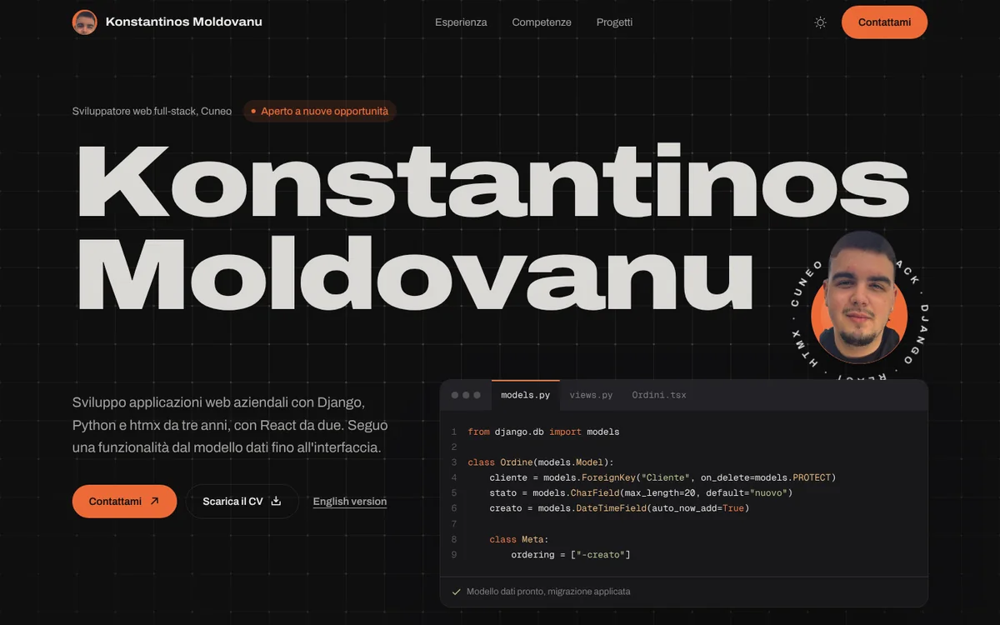

# Konstantinos Moldovanu — portfolio

Sito personale di Konstantinos Moldovanu, sviluppatore web full-stack a Cuneo (Python, Django, htmx, React).

**Online:** [kmoldovanu.vercel.app](https://kmoldovanu.vercel.app)



## Cosa c'è dentro

- **Una pagina sola**: presentazione, esperienza, competenze, progetti e contatti.
- **Hero animata**: il nome sale lettera per lettera, una griglia reagisce al cursore (un clic manda un'onda) e un editor di codice si scrive da solo, dal modello Django alla vista React.
- **Animazioni legate allo scroll** con Motion, caricato con `LazyMotion` per includere solo le funzioni che servono.
- **Tema chiaro e scuro**: segue il sistema, si può cambiare a mano e la scelta viene ricordata senza lampeggi al caricamento.
- **Accessibilità**: con "riduci movimento" attivo tutto resta fermo, focus sempre visibile, link per saltare al contenuto, form con errori collegati ai campi.
- **Form di contatto funzionante**: una funzione serverless su Vercel valida il messaggio e lo inoltra per email con Resend. Un campo esca blocca i bot; se l'invio fallisce il messaggio si può mandare dal proprio programma di posta.
- **CV scaricabile** in italiano e in inglese.

## Stack

React 19 · TypeScript · Vite · Tailwind CSS 4 · Motion · Phosphor Icons · funzione serverless Vercel + Resend

## Avvio in locale

Serve Node.js 20.19 o superiore (c'è un `.nvmrc`).

```bash
npm install
npm run dev       # http://localhost:5173
npm run build     # controllo dei tipi + build di produzione in dist/
```

In locale il form non può inviare (la funzione `/api/contact` gira solo su Vercel): mostra l'errore con il link per scrivere via email. Per provarlo davvero usa `vercel dev`.

## Deploy su Vercel

1. Importa il repository: Vercel riconosce Vite da solo.
2. In *Settings → Environment Variables* aggiungi:

| Variabile | Obbligatoria | A cosa serve |
|---|---|---|
| `RESEND_API_KEY` | sì | chiave di [Resend](https://resend.com) per inviare i messaggi del form |
| `CONTACT_TO` | no | dove ricevere i messaggi (predefinito: l'email del portfolio) |
| `CONTACT_FROM` | no | mittente; senza un dominio verificato su Resend resta `onboarding@resend.dev`, che può scrivere solo all'indirizzo dell'account Resend |

## Dove modificare cosa

```
src/content.ts             tutti i testi, i link, l'esperienza e i progetti
src/index.css              colori (chiaro e scuro) e font
src/components/sections/   una sezione della pagina per file
src/components/ui/         componenti riusabili (pulsanti, campi, card inclinabili, foto, editor)
api/contact.ts             funzione serverless del form di contatto
public/                    foto, CV in PDF e immagini dei progetti
```
